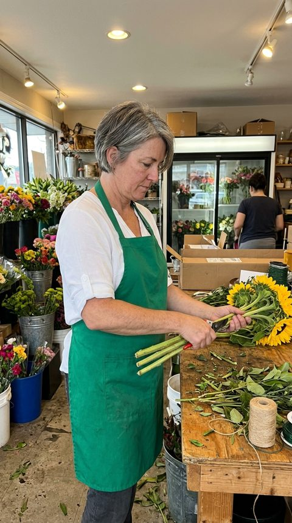
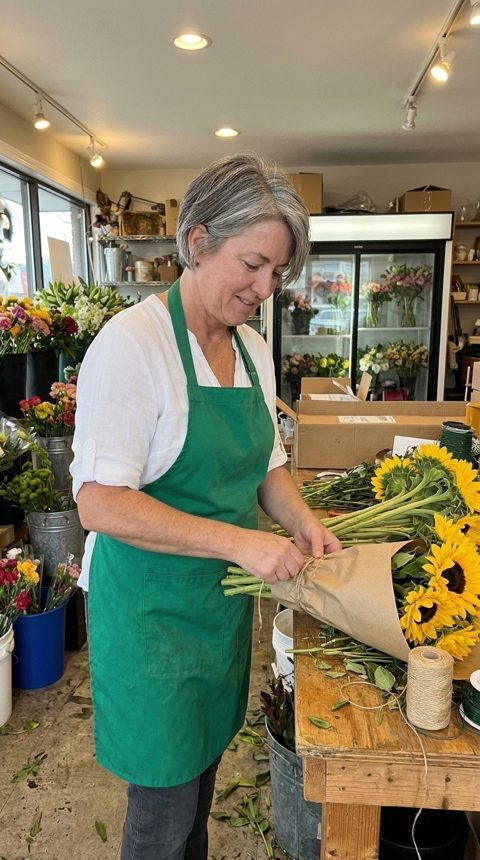

# Google Flow para o Claude Code

Skill (plugin) para o **Claude Code** gerar imagens (**Nano Banana**) e vídeos (**Omni**) no **Google Flow** usando o seu próprio Chrome. Você pede em português, o Claude escreve o prompt, gera e baixa o arquivo, e **sempre mostra o custo em créditos antes de gerar**.

> Projeto independente. Não é do Google nem afiliado ao Google. Google Flow, Nano Banana, Omni e Veo são marcas do Google.

## Exemplo

> *"Gera uma imagem natural, estilo foto de celular, de uma florista de uns 45 anos cortando girassóis. Depois a mesma mulher embrulhando o buquê."*

| Cena 1 | Cena 2 (mesma pessoa, com a cena 1 como referência) |
|---|---|
|  |  |

Duas imagens, 0 créditos. O Claude mostrou o custo antes, gerou, conferiu mãos e rosto e entregou os arquivos.

<details>
<summary><b>In English</b></summary>

A Claude Code plugin that generates images (Nano Banana) and videos (Omni) in Google Flow using your own Chrome, with one command per generation instead of having Claude click through the screen. It asks your preferences on first use, writes prompts from built-in recipes (natural/UGC, corporate, product, motion backgrounds) or uses yours as-is, plans multi-scene projects with a storyboard and batch generation, joins clips into one video with ffmpeg, and **always shows the credit cost and waits for your OK before spending anything**. The skill text is in Portuguese; Claude answers in your language.

Install: `/plugin install google-flow --marketplace WanessaCelys/claude-google-flow`. Requirements: Claude Code, Python 3.10+, Google Chrome, a Google account with Flow access. Independent project, not affiliated with Google.
</details>

## O que ela faz

- **Imagens e vídeos no Flow** com um comando por geração, sem o Claude ficar clicando na tela passo a passo (gasta bem menos tokens).
- **Perguntas no primeiro uso:** estilo, idioma da fala, música, legendas, formato, download em 1080p e uso de mais de uma conta. As respostas guiam todos os pedidos seguintes.
- **Receitas de prompt:** natural (foto e vídeo de celular, UGC, depoimento), institucional, produto e fundos para motion. Se você já tem seus prompts, ela usa o seu texto exatamente como está.
- **Modo projeto:** para pedidos com várias cenas, monta roteiro e storyboard com o custo, gera as imagens em lote (de graça), espera a sua aprovação e só então gera os vídeos.
- **Storyboard visual:** em projetos com várias cenas, abre uma página com o roteiro, os prompts, as imagens e o custo de cada cena, para você aprovar antes de gastar.
- **Clipes de 10 s dirigidos:** o mais barato por segundo; o Claude dirige várias ações e movimentos de câmera dentro de cada clipe.
- **Juntar os vídeos:** une as cenas num vídeo só, com corte seco ou transições (suave, deslizar, círculo, zoom) em cada junção, aproveitando só o trecho bom de um clipe se precisar, e música de fundo opcional. Roda no seu computador e não gasta crédito.
- **Vídeos em 720p** (o tamanho original do Flow, recomendado) e, se você quiser, **download em 1080p** (opcional, cobrado à parte pelo Flow).

## Requisitos

- [Claude Code](https://claude.com/claude-code) instalado no computador (não funciona no claude.ai pelo navegador: a skill precisa abrir o Chrome local).
- **Python 3.10+** e **Google Chrome**.
- Uma conta Google com acesso ao Google Flow. Imagens não gastam crédito; vídeos precisam de um plano com créditos.

## Instalar

**Jeito mais fácil:** abra o Claude Code e peça:

```
Instala o plugin do GitHub WanessaCelys/claude-google-flow
```

**Ou pelo comando do Claude Code** (um passo, Claude Code 2.1.275 ou mais novo):

```
/plugin install google-flow --marketplace WanessaCelys/claude-google-flow
```

Em versões mais antigas, em dois passos:

```
/plugin marketplace add WanessaCelys/claude-google-flow
/plugin install google-flow@claude-google-flow
```

Depois de instalar, feche e abra o Claude Code de novo.

**Ou manualmente:** baixe este repositório (botão *Code → Download ZIP*) e copie a pasta `plugins/google-flow/skills/flow` para `~/.claude/skills/flow` (no Windows: `C:\Users\<você>\.claude\skills\flow`).

## Primeiro uso

Peça qualquer coisa como *"gera uma imagem no Flow de uma mulher numa cafeteria, estilo foto de celular"*. Na primeira vez o Claude:

1. instala o Playwright e o ffmpeg (`pip install playwright imageio-ffmpeg`);
2. abre uma janela do Chrome para **você** entrar na sua conta Google (o Claude nunca vê nem digita a sua senha);
3. faz as perguntas de preferência e guarda as respostas.

Exemplos de pedidos:

- *"Gera 3 imagens naturais de uma barbearia de bairro, 9:16."*
- *"Usa este prompt exatamente como está e gera em 16:9: …"*
- *"Faz um anúncio de 3 cenas para a minha padaria, com uma cliente falando em português."*
- *"Baixa em 1080p o vídeo que acabamos de gerar."*
- *"Junta as 3 cenas num vídeo só, com transição suave e esta música."*

## Custos (créditos do Google Flow, conferidos em 16/11/2026)

| O quê | Créditos |
|---|---|
| Imagem (Nano Banana) | 0 |
| Vídeo 4 s / 6 s / 8 s / 10 s (Omni 1.1, 720p) | 7 / 10 / 12 / 15 |
| Vídeo 11 a 15 s (Omni 1.2, 720p) | 36 a 60 |
| Download em 1080p (opcional; o recomendado é 720p, sem custo extra) | +5 por vídeo, além dos créditos da geração |

O Google muda esses valores. A skill confere o preço que o próprio Flow mostra antes de cada geração e para, sem gastar, se for diferente do combinado. **O Omni 1.1 sai do Flow em 5/12/2026**; depois disso os vídeos usam o Omni 1.2, que custa o dobro.

## Segurança e privacidade

- **Tudo roda no seu computador.** O login fica salvo só na sua máquina (`~/.config/flow`). A skill não envia nada para servidores além do próprio Google Flow.
- **O Claude nunca digita senha.** Você entra na sua conta na janela do Chrome que a skill abre.
- **Nenhum crédito é gasto sem o seu ok.** Vídeos só são gerados depois que você aprova o custo, e a skill nunca clica em "Fazer upgrade" ou "Adicionar créditos".
- **A janela do robô:** enquanto está aberta, o Chrome do robô aceita controle de programas do seu próprio computador (sites não conseguem). Ele só se conecta ao Chrome do perfil dele e recusa qualquer outro. Quando terminar, peça ao Claude para fechar a janela (`flow.py fechar`); o login continua salvo. Não use em computador compartilhado.
- **Arquivos:** o robô só grava dentro da pasta do projeto, não sobrescreve arquivo existente e, se uma geração não baixar, rodar de novo só baixa, sem gastar outra vez.
- **Termos do Google:** os termos costumam proibir automação e o uso de várias contas para somar créditos, com risco de bloqueio da conta. O recomendado é usar uma conta só. Você é responsável pelo uso da sua conta.
- O código é aberto: o robô está em [`plugins/google-flow/skills/flow/scripts/flow.py`](plugins/google-flow/skills/flow/scripts/flow.py) e pode ser lido antes de instalar.

## Atualizar e desinstalar

```
/plugin update google-flow@claude-google-flow
/plugin uninstall google-flow@claude-google-flow
```

Para apagar também o login e as preferências salvas, apague a pasta `~/.config/flow`.

## Problemas comuns

- **"O Flow mudou a tela" / um botão não é encontrado:** peça ao Claude *"o Flow mudou, roda o mapear e corrige"*. Ele só ajusta os nomes dos botões e mostra a mudança antes de usar.
- **Gerou mas não baixou:** peça de novo. O robô só baixa o que já foi gerado, sem cobrar outra vez.
- **Pede para aceitar "Direitos de uso desta imagem":** acontece só na primeira vez. Aceite na janela do Chrome e peça de novo.
- **Não achou o Chrome:** instale o Google Chrome ou defina a variável `FLOW_CHROME` com o caminho dele.

## Licença

[MIT](LICENSE). Use, modifique e compartilhe à vontade.
